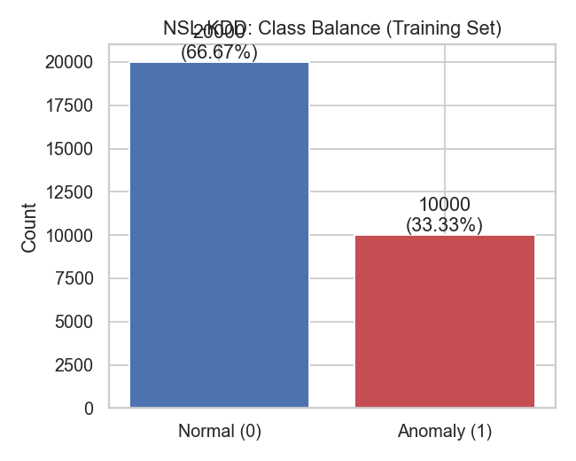
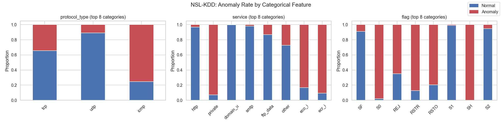
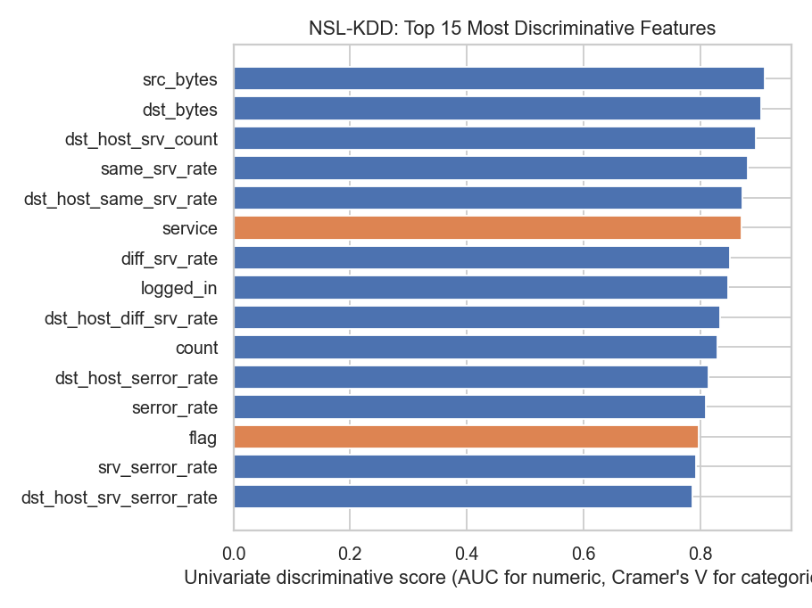
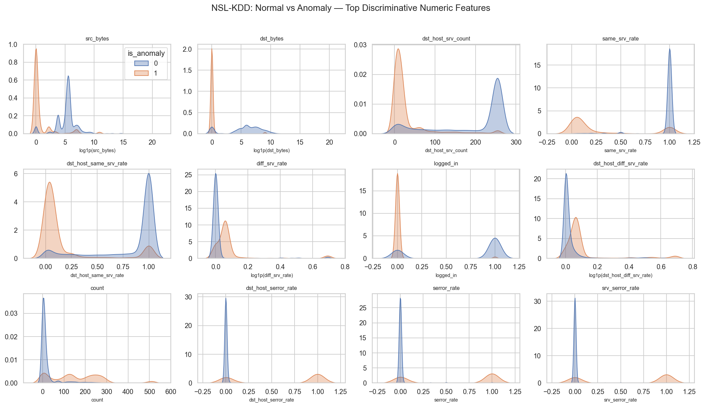
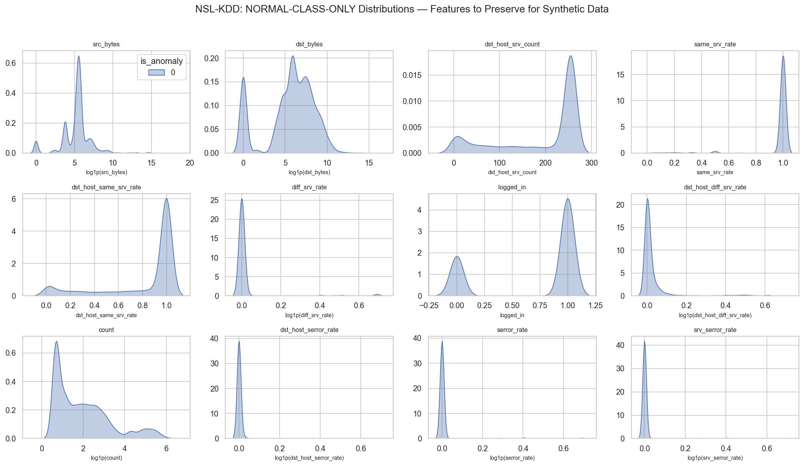
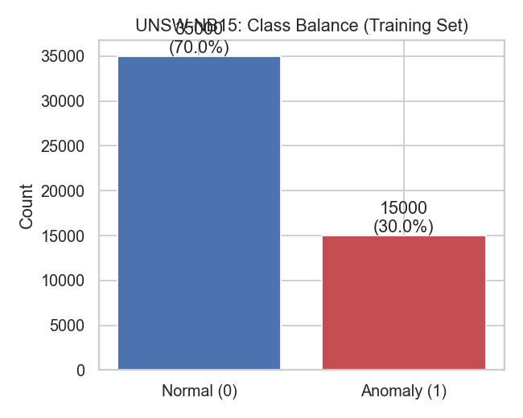
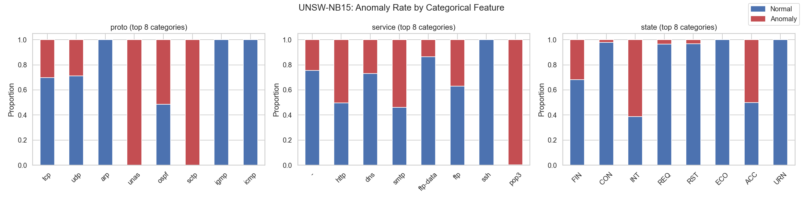
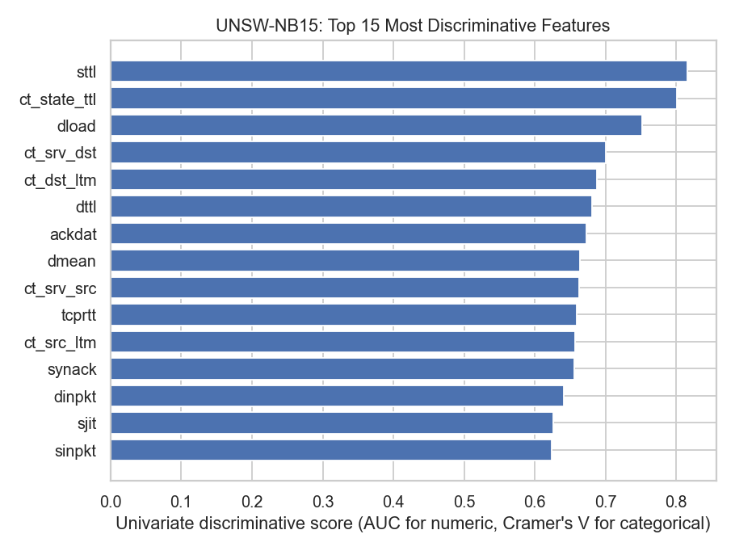
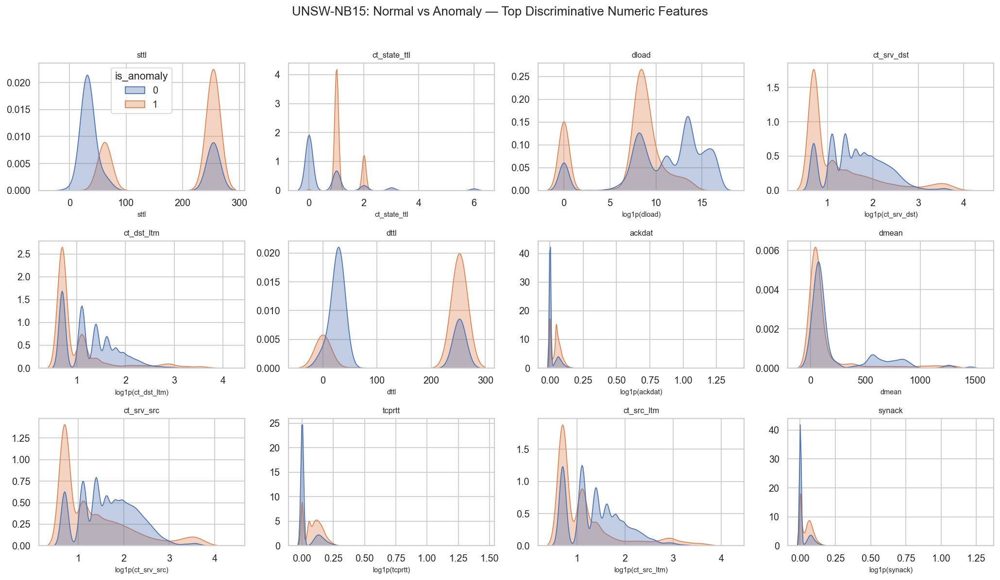
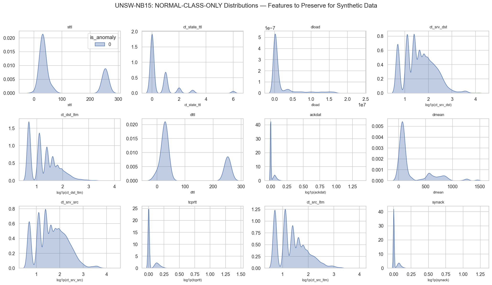

# EDA Report — NSL-KDD & UNSW-NB15 (Tabular Data Augmentation for Anomaly Detection)

Both datasets are analyzed with the **same pipeline** (`eda_pipeline.py`), so results
are directly comparable. Per the problem formulation, only the labeled training set
is available; it contains normal samples plus anomalies from the training-visible
attack types (`A_seen`) only — validation/test add unseen attack types, so training-set
statistics (e.g. class balance, per-feature normal-vs-anomaly separation) may not fully
transfer to validation/test.

## Cross-Dataset Comparison
| Metric | NSL-KDD | UNSW-NB15 |
|---|---|---|
| Rows | 30,000 | 50,000 |
| Numeric features | 38 | 39 |
| Categorical features | 3 | 3 |
| Anomaly % | 33.33% | 30.0% |
| Duplicate rows | 1 | 0 |
| Top discriminative feature | src_bytes | sttl |
| Most skewed normal-class feature (top-8 discriminative) | src_bytes | dinpkt |

Both datasets are network-traffic intrusion data with the same general schema —
numeric connection/flow statistics, 3 categorical protocol-related fields, and a binary
`is_anomaly` label — so the same generation/augmentation approach can reasonably be
applied to both, with dataset-specific feature scaling/encoding.

## NSL-KDD

### Overview
- Rows: 30,000 | Columns: 42
- Numeric features: 38 | Categorical features: 3
- Duplicate rows: 1 | Missing cells: 0
- Class balance: Normal 20,000 (66.67%) / Anomaly 10,000 (33.33%)
  — reflects `A_seen` attack types only, per the project's train/valid/test split design.

### Categorical Features
| feature       |   n_unique | top_value   |   top_value_pct |
|:--------------|-----------:|:------------|----------------:|
| protocol_type |          3 | tcp         |           80.94 |
| service       |         67 | http        |           39.05 |
| flag          |         11 | SF          |           68.87 |

### Most Discriminative Features (Normal vs Anomaly, univariate)
- **src_bytes** (numeric): AUC = 0.910
- **dst_bytes** (numeric): AUC = 0.904
- **dst_host_srv_count** (numeric): AUC = 0.895
- **same_srv_rate** (numeric): AUC = 0.881
- **dst_host_same_srv_rate** (numeric): AUC = 0.873
- **service** (categorical): Cramer's V = 0.871
- **diff_srv_rate** (numeric): AUC = 0.850
- **logged_in** (numeric): AUC = 0.847

### Correlation Structure
Pairwise numeric correlations: `nslkdd/05_correlation_heatmap.png` — useful for spotting
redundant/derived features (e.g. rate features computed from raw counts) that a
generator must reproduce jointly, not independently.

### Outliers (IQR rule, full training set)
- dst_host_serror_rate: 24.1% of rows flagged
- srv_diff_host_rate: 23.1% of rows flagged
- dst_host_srv_serror_rate: 21.4% of rows flagged
- dst_host_same_src_port_rate: 18.5% of rows flagged
- dst_bytes: 14.6% of rows flagged

Note: in intrusion data, IQR "outliers" often coincide with the anomaly class rather
than being data-quality noise — not something to clean away by default.

### Normal-Class-Only Shape (what the generator must reproduce)
Since the submission must be **normal-only**, the shape of each feature's *normal*
distribution — not the normal-vs-anomaly contrast above — is what a generator needs
to match. Most skewed/zero-inflated features among the top discriminative ones:
- src_bytes: skew=128.63, excess kurtosis=17528.84, % zero=5.1%
- dst_bytes: skew=74.79, excess kurtosis=6686.69, % zero=16.3%
- dst_host_srv_serror_rate: skew=12.84, excess kurtosis=177.38, % zero=91.9%
- srv_serror_rate: skew=8.79, excess kurtosis=85.33, % zero=96.3%
- serror_rate: skew=8.25, excess kurtosis=73.85, % zero=96.4%

## UNSW-NB15

### Overview
- Rows: 50,000 | Columns: 43
- Numeric features: 39 | Categorical features: 3
- Duplicate rows: 0 | Missing cells: 0
- Class balance: Normal 35,000 (70.0%) / Anomaly 15,000 (30.0%)
  — reflects `A_seen` attack types only, per the project's train/valid/test split design.

### Categorical Features
| feature   |   n_unique | top_value   |   top_value_pct |
|:----------|-----------:|:------------|----------------:|
| proto     |         86 | tcp         |           76.42 |
| service   |         13 | -           |           61.9  |
| state     |          8 | FIN         |           72.33 |

### Most Discriminative Features (Normal vs Anomaly, univariate)
- **sttl** (numeric): AUC = 0.815
- **ct_state_ttl** (numeric): AUC = 0.800
- **dload** (numeric): AUC = 0.752
- **ct_srv_dst** (numeric): AUC = 0.700
- **ct_dst_ltm** (numeric): AUC = 0.687
- **dttl** (numeric): AUC = 0.681
- **ackdat** (numeric): AUC = 0.673
- **dmean** (numeric): AUC = 0.664

### Correlation Structure
Pairwise numeric correlations: `unsw/05_correlation_heatmap.png` — useful for spotting
redundant/derived features (e.g. rate features computed from raw counts) that a
generator must reproduce jointly, not independently.

### Outliers (IQR rule, full training set)
- dbytes: 21.3% of rows flagged
- dmean: 20.7% of rows flagged
- spkts: 16.8% of rows flagged
- sload: 15.8% of rows flagged
- dload: 15.1% of rows flagged

Note: in intrusion data, IQR "outliers" often coincide with the anomaly class rather
than being data-quality noise — not something to clean away by default.

### Normal-Class-Only Shape (what the generator must reproduce)
Since the submission must be **normal-only**, the shape of each feature's *normal*
distribution — not the normal-vs-anomaly contrast above — is what a generator needs
to match. Most skewed/zero-inflated features among the top discriminative ones:
- dinpkt: skew=23.82, excess kurtosis=650.84, % zero=8.3%
- sjit: skew=20.04, excess kurtosis=450.20, % zero=21.8%
- sinpkt: skew=10.99, excess kurtosis=121.54, % zero=0.0%
- synack: skew=10.72, excess kurtosis=233.35, % zero=26.1%
- ackdat: skew=10.54, excess kurtosis=279.06, % zero=26.1%

## Implications for the Augmentation Task
1. **Target the normal-class distribution specifically.** The submission must contain
   only synthetic normal samples; the "Normal-Class-Only Shape" sections above (not the
   normal-vs-anomaly contrast plots) are what a generator needs to match.
2. **Several top-discriminative numeric features are heavily skewed / zero-inflated**
   even within the normal class (see skew/kurtosis tables) — a plain multivariate
   Gaussian generator will misrepresent these; log-transforms, copula-based methods, or
   models like CTGAN/TVAE that handle mixed/skewed tabular data are better starting
   points than naive Gaussian sampling.
3. **Categorical features have a few dominant categories** (see categorical summaries)
   — the generator should preserve normal-class category frequencies rather than
   sampling categories uniformly or from the full (normal+anomaly) distribution.
4. **Numeric features are correlated** (correlation heatmaps) — several are arithmetic
   derivatives of others (e.g. `*_rate` features derived from counts in both datasets).
   A generator that samples features independently will break these dependencies and
   produce internally-inconsistent synthetic rows; joint/multivariate generation is
   preferred over per-column generation.
5. **Downstream detectors will likely lean on the top-ranked discriminative features**
   identified here — synthetic normal data that fails to reproduce their normal-class
   marginal and joint behavior is likely to hurt downstream AUPRC most.

## Files
- `eda_pipeline.py` — the pipeline script (run with `python3 eda_pipeline.py`)
- `eda_output/report.md` — this report
- `eda_output/<nslkdd|unsw>/*.png`, `*.csv` — supporting figures and tables per dataset
